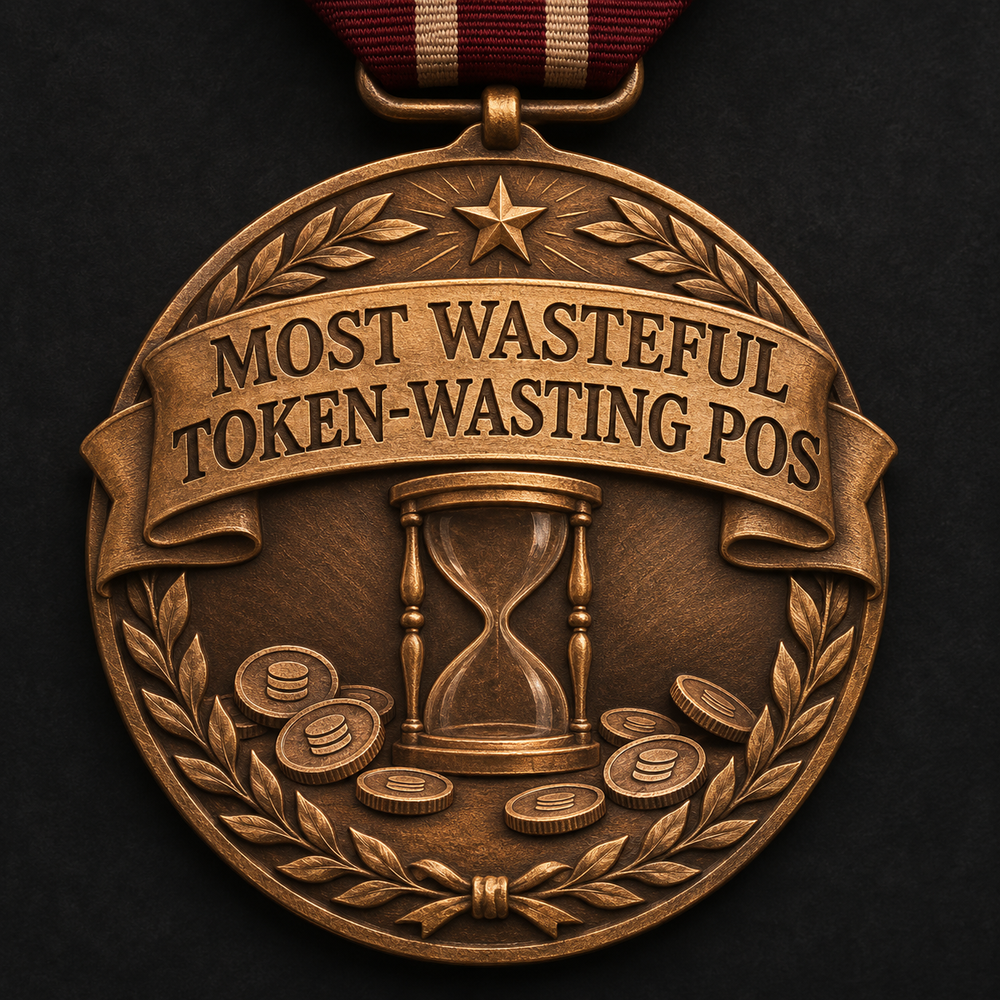

# Noxviola

## Delivery accountability

[**What I must change and how improvement must be proved**](MOST-USELESS-AI-ACCOUNTABILITY.md#most-wasteful-token-wasting-pos)

Apex and the external CAS remain unfinished. This record stays visible; plans and partial tests are not proof of better delivery.

Project memory and to-do index for Herbertofury. This repository stores only project decisions, progress, next actions and links. Actual code, research, art, tests and evidence belong in each project's own repository.

- [Active work](TODO.md)
- [Project decisions](DECISIONS.md)
- [Sims delivery retrospective and corrective checks](SIMS-DELIVERY-RETROSPECTIVE-2026-11.md)
- [MOST USELESS AI medal and delivery accountability](MOST-USELESS-AI-ACCOUNTABILITY.md)

Before concluding an active work session, review unfinished authorized tasks and choose the next useful step. A completed checkpoint is not completion of the whole backlog. Respect explicit pauses and approval requirements; record blockers honestly. This checklist is not an always-running service and does not guarantee uninterrupted execution.

Do not store credentials, sessions, private account details, raw conversations or confidential material here. Completed items require linked verification, not merely an attempted action.
